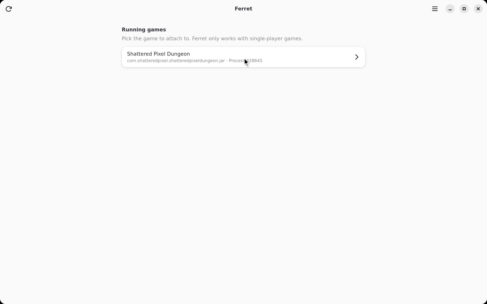
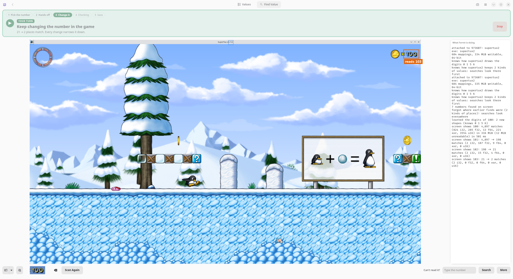
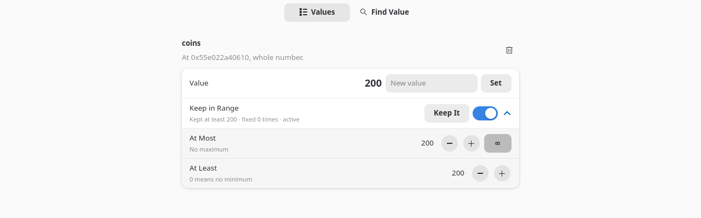

# Ferret

**Find and change values in your games.** Health, gold, ammo: pick the number in the game's
window, play a little, and Ferret finds where the game keeps it. Then set it, keep it from going
down, and get it back automatically every time you play. For single-player games on Linux.

If you know Cheat Engine or GameConqueror (scanmem): Ferret is a memory editor in that family, made so you don’t need to know what a memory scan is.



<sub>[Shattered Pixel Dungeon](https://shatteredpixel.com/)'s gold picked from Browse and set to 9999.</sub>

## Install

**Linux:** open [ferret.flatpakref](https://petru101.github.io/ferret-updates/ferret.flatpakref)
with your software centre, or run (Ferret uses the GNOME runtime from Flathub, already set up on
most distros):

```sh
flatpak install --user https://petru101.github.io/ferret-updates/ferret.flatpakref
```

New versions then come with your other Flatpak updates. The `.flatpak` file on the
[latest release](https://github.com/Petru101/ferret/releases/latest) installs the same way
(`flatpak install --user ferret-<version>-x86_64.flatpak`) and gets updates too. On Bazzite
(Bazaar) and other stores that don't open the `.flatpakref`, use the command above or the
`.flatpak` file.

**Windows:** download `Ferret-<version>-setup.exe` from the
[latest release](https://github.com/Petru101/ferret/releases/latest) and run it (installs for
your account, no administrator needed; Windows may warn about an unknown publisher, since it
isn't signed). Ferret downloads new versions by itself and installs them at its next start, or
right away with Restart. The portable zip updates itself the same way.

Ferret is young: it works on the games listed below, and feedback on others is welcome (Send
Feedback in its menu, or an issue here).

## How it works

1. **Open your game** from the list of running games.
2. **Click the number** in the picture of the game window (or drag a box around it, around a
   health bar, or around a row of hearts). Ferret reads it, and learns how the game draws its
   digits as you go. If it can't read it, type the number instead.
3. **Press Start and play.** The bar at the top tells you when to keep your hands off and when
   it's your turn to change the number: pick up some coins, take a hit. Every change narrows the
   search. When a few places are left that all follow the number, Ferret writes test values to
   tell the real one from the game's display copies; if it still can't tell, you try them.

   
4. **Save it with a name.** Ferret works out how the game gets to the value, so it finds it
   again after the game restarts, usually within a second or two of opening the game.
5. **Change it** in the Values tab, or **keep it in a range** (Keep It: never below the number
   now). Limits keep working while you play, even with Ferret's window closed; a hotkey turns
   them off and on from inside the game.

   
6. **More like this**: found one power's timer or one unit's health? Find Them on its card
   watches the game's code that changes it while you use the others, and saves each one with
   the same range.
7. **Browse by name** (Unreal Engine, Unity, Godot, GameMaker, RPG Maker MV and MZ, Java, Python (Ren'Py, pygame), Adobe AIR, Lua games such as LÖVE's, and web games in recent Electron versions: plain JavaScript, Phaser, GDevelop or Construct 2): the Browse tab lists your character's numbers by
   the names the game gives them (health, ammo, run speed, jump height; in RPG Maker games the
   party's gold and items, each hero's HP, MP and level, the game's variables), no search needed.
   In Unreal Engine, Unity and RPG Maker games it lists their on/off flags too, with a switch to
   flip them: the character's "can be damaged" (off: no damage, in games that take damage the
   engine's way), the game's own flags, and an RPG Maker game's switches by the names its maker
   gave them. Above the list, one-click tweaks: god mode and fly in Unreal Engine games (they
   work where the game leaves damage and movement to the engine); in RPG Maker games god mode
   (your heroes' HP and MP don't go down), walk through walls, no random battles and walk faster.
   Turn on Only What Changes, change one in the game, and save the one that moved, or type the
   number the game shows into the search box to see which names hold it.

Notifications tell you what Ferret needs while the game is in front, even in fullscreen.

## Single-player only

Ferret refuses online games: games with anti-cheat running, online-only games and MMOs, games
with Valve Anti-Cheat, and games that flag edited characters online (Elden Ring, the Souls
games). If anti-cheat starts while Ferret is open, it lets go of the game at once. Games with a
multiplayer mode, or with anti-cheat that isn't running, open with a warning to play offline.

There are no store lookups over the network. Ferret checks Steam's and Heroic's local cache for
game info, has a copy of [AreWeAntiCheatYet](https://areweanticheatyet.com/)'s list of games
with anti-cheat, looks for anti-cheat programs running, and checks the game's folder for
anti-cheat files.

## Games

Native Linux games and Windows games under Proton or Wine, from Steam, Heroic, Lutris or anywhere
else. Ferret finds values again by the game's own code, by the names Unreal, Unity (Mono and
IL2CPP), Godot, GameMaker, RPG Maker MV and MZ, Java, Python, Adobe AIR (32-bit), Lua (LuaJIT: LÖVE, Defold) and Electron web games give their objects and variables, or by pointer paths. Tried so far, among others:
SuperTux, Terraria, Valheim, ULTRAKILL, Creeper World 4, Brotato, Lumencraft, Forager, Prey,
Mass Effect: Andromeda, Starship Troopers: Ultimate Bug War!, Quake II RTX, Skyrim Special Edition,
Shattered Pixel Dungeon (Java), Creeper World Anniversary Edition (Adobe AIR), and Flash games in Ruffle.

Values a game hides (memory scramblers like CodeStage Anti-Cheat Toolkit in some Unity games)
can't be found: Ferret says so when you open such a game.

## Sharing

- **Export / import:** a game's saved values as a small `.ferret` text file, or copied to paste
  in a chat. Imported values aren't changed until you confirm the game shows their number.
- **Shared library:** browse values other players shared for the same game, and share your own
  (only values you confirmed, nothing about you or your computer). When you confirm or remove a
  value you got from it, Ferret tells the library whether it worked.
- **Send Feedback:** a message to the developer, optionally with Ferret's log (your home
  folder's path taken out) and the game's saved values. You see exactly what's sent.

Ferret goes online only for these (its own server, on Cloudflare); nothing else leaves your
computer.

## Languages

English, German, Spanish, French, Italian, Polish, Brazilian Portuguese, Russian and Simplified
Chinese. The translations are machine-made and not reviewed by native speakers yet: corrections
are welcome (`po/`).

## Building

Ferret is a flatpak (GTK 4 and libadwaita, written in Rust). It needs the GNOME 50 SDK and the
Rust extension:

```sh
flatpak install --user flathub org.gnome.Sdk//50 org.freedesktop.Sdk.Extension.rust-stable//25.08 org.flatpak.Builder
# the crates, once and after changing dependencies (vendor/ is gitignored)
mv .cargo/config.toml .cargo/config.toml.off
flatpak run --share=network --filesystem="$PWD" --command=sh org.gnome.Sdk//50 \
    -c 'cd "$0" && /usr/lib/sdk/rust-stable/bin/cargo vendor --versioned-dirs vendor' "$PWD"
mv .cargo/config.toml.off .cargo/config.toml
# build and install
flatpak run org.flatpak.Builder --user --install --force-clean --disable-rofiles-fuse \
    build-dir io.github.Petru101.Ferret.yml
flatpak run io.github.Petru101.Ferret
```

The app is sandboxed; reading and writing a game's memory happens in a small helper
(`ferret-helper`, Rust with only the standard library and libc, linked statically) that Ferret
starts on the host with `flatpak-spawn --host`, because games run outside the sandbox. The game
window comes through the ScreenCast portal: only the window you pick, never your desktop. If your
system doesn't allow one program to read another's memory (`kernel.yama.ptrace_scope`), Ferret
explains how to allow it.

`flatpak run io.github.Petru101.Ferret --cli` is a text interface used by the test scripts:
`test-game/` has a stand-in game and scripts that drive it (natively, under Proton and in the
Steam Linux Runtime), and `bench/` compares OCR engines on saved game frames.

## Third-party data

- Numbers are read with PaddlePaddle's PP-OCRv6 small text detection and recognition models
  ([PaddleOCR](https://github.com/PaddlePaddle/PaddleOCR), Apache License 2.0), downloaded from
  PaddlePaddle's Hugging Face repositories at build time and run with
  [rten](https://github.com/robertknight/rten).
- `data/areweanticheatyet/games.json` is a trimmed copy of AreWeAntiCheatYet's `games.json`
  (MIT License, Copyright © 2021 Starz0r, Curve; see `data/areweanticheatyet/LICENSE` and
  `SOURCE`). Refresh it with `data/areweanticheatyet/update.sh` before a release.
- The Rust crates Ferret is built from (MIT, Apache-2.0, BSD, ISC and similar licenses) are
  listed with their license texts in `data/third-party/THIRD-PARTY-LICENSES.txt`, installed with
  the app in `/app/share/licenses/io.github.Petru101.Ferret/`. Regenerate it with
  `python3 data/third-party/update.py` after changing dependencies.

## Made with AI

Most of Ferret's code, its translations and this README were written by Claude (Anthropic's AI).
Its author designed it, directed every change and tests it on real games.

## License

GPL-3.0-or-later (`LICENSE`).
